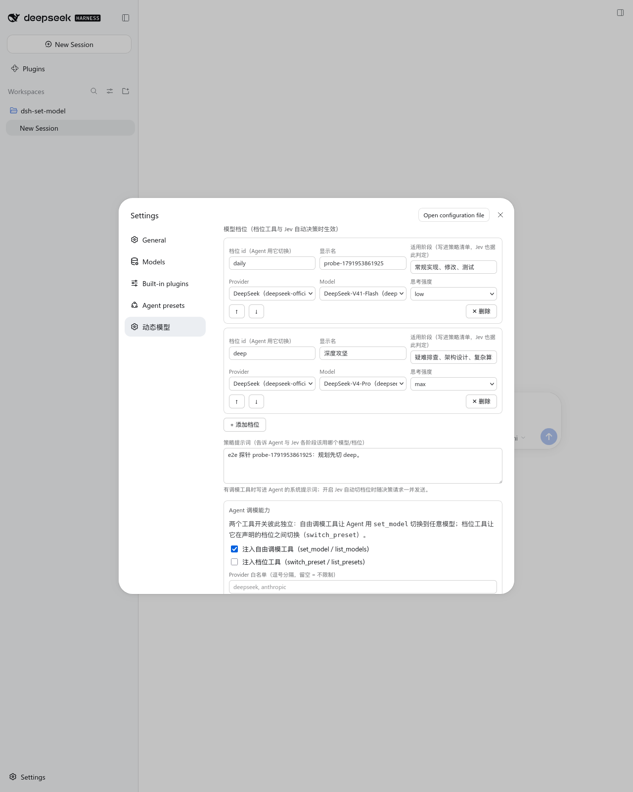

# dsh-set-model

<p align="center">
  <a href="./README.md"><strong>简体中文</strong></a> ·
  <a href="./README.en.md"><strong>English</strong></a>
</p>

为 DeepSeek Harness（DSH / cordis plugin）提供**模型策略**：把"什么任务用什么模型、思考多深"变成部署可声明、Agent 可遵守、还能每轮自动判定的显式规则。

- **自动换档（Jev）**：接入 TypeSafe Jev 决策模型，每轮对话开局读一次你的最新指令判断任务类型，自动在声明的档位间换档——排查疑难升到高推理档位，改文案、跑测试回到日常档位，不用手动干预、也不必在提问时交代"用深度思考"；档位只声明思考强度时，换档就是**在同一个模型上自动调节思考深度**；
- **自由调模工具**：Agent 用 `set_model` / `list_models` 按任务难度自主切换 provider、model 与 reasoningEffort；
- **档位工具**：部署声明一组「模型 + 思考强度」档位，Agent 只能在档位间切换（`switch_preset` / `list_presets`）；档位可以只声明思考强度而不绑定模型（`provider` / `model` 留空 = 沿用当前模型），从而只调节思考深度；未声明 `presets` 时内置 `low` / `medium` / `high` 三档；
- 自动换档与两个工具面开关**彼此独立**，可任意组合（只开 Jev、只开工具、都开、都关）；
- 可配置一段**策略提示词**，写进系统提示词告诉 Agent 各阶段该用哪个档位；
- 插件把当前模型与档位注入运行时上下文，并随 Plan 模式自动升降级。

攻坚疑难问题时升到高推理档位，日常执行保持高性价比档位——开启 Jev 后这条策略每轮自动执行，不再需要用户手动改配置。



## 三个独立开关

| 开关 | 默认 | 作用 |
|---|---|---|
| `enableModelTools` | `true` | 注入 `set_model` / `list_models`，Agent 可切换到任意已注册 provider / model / 思考强度 |
| `enablePresetTools` | `false` | 注入 `switch_preset` / `list_presets`，Agent 只能在 `presets` 声明的档位间切换（默认三档只调思考强度） |
| `jevEnabled` | `false` | Jev 每轮自动决策档位，**不依赖上面两个工具**，也不受它们影响 |

> 档位工具约束的是 **Agent 的工具面**；你在 GUI 模型选择器里的手动切换不受限制（DSH 未提供拦截用户切模的插件接口），可作为人工兜底通道。三个开关都不影响 GUI 的既有行为。

## 模型策略提示词

配置 `policyPrompt` 会作为 `## Model policy` 段落写进系统提示词；开启档位工具或 Jev 时，插件还会自动追加档位清单：

```yaml
policyPrompt: |
  规划与疑难排查一律先切 deep；日常实现、改文件、跑测试用 daily。
```

开启档位工具后 Agent 实际看到的（由 `presets` 的 `id`/`name`/`when` 自动生成，无需手写）：

```
## Model policy

规划与疑难排查一律先切 deep；日常实现、改文件、跑测试用 daily。

本部署只允许在下列模型档位之间切换；进入对应阶段时调用 switch_preset 换档：

- **daily（日常执行）** — deepseek/deepseek-chat · reasoning low — 适用：常规实现、修改、测试
- **deep（深度攻坚）** — deepseek/deepseek-reasoner · reasoning max — 适用：疑难排查、架构设计
```

未配置任何策略时段落为空，不会在提示词里留下痕迹。

## 模型看到什么

插件通过 `systemPrompt.context` 把当前活跃模型注册进每个 step 组装的 Runtime Context 快照（该快照仅在文本变化时才追加新的一条，内容相同则复用上一条，因此稳定轮次里只落一条 cache-safe 追加；模型随时自查、无需调用工具）：

```
[Current active model: deepseek/deepseek-chat · reasoning: low · preset: daily]
```

处于 Plan 模式时附带状态标记：

```
[Current active model: deepseek/deepseek-reasoner · reasoning: max · preset: deep] [Plan Mode Active]
```

`preset: xx` 仅在当前模型命中某个档位时出现。

## 工具

### set_model（自由调模工具）

`set_model({ provider?, model?, reasoningEffort?, reason })` —— `reason` 必填（每次切换都会使会话 KV cache 失效，工具说明要求 Agent 给出理由、避免频繁切换）：

```json
{ "model": "deepseek-reasoner", "reasoningEffort": "high", "reason": "疑难并发问题排查，需要深度推理" }
```

### list_models（自由调模工具）

`list_models({ provider? })` 列出已注册 Providers 与模型能力（推理档位、上下文窗口）：

```
# Available Providers & Models:

## Provider: deepseek
- **deepseek-reasoner** (DeepSeek Reasoner) | Reasoning: [low, high, max] | Context: 128000
- **deepseek-chat** (DeepSeek Chat) | Context: 128000
```

### switch_preset（档位工具）

`switch_preset({ preset, reason })` —— `preset` 是配置里的档位 id，`reason` 必填；id 不存在时返回可用档位清单：

```
Model preset switched to deep (深度攻坚) — deepseek/deepseek-reasoner · reasoning: max. Effective from the next step.
Reason: 疑难并发问题排查，需要深度推理
```

### list_presets（档位工具）

`list_presets({})` 列出允许的档位、各自适用阶段与当前生效档位：

```
# Model presets

Mode: preset · Plan Mode active
Current: deepseek/deepseek-reasoner · reasoning max · preset deep

- **daily（日常执行）** — deepseek/deepseek-chat · reasoning low — 适用：常规实现、修改、测试
- **deep（深度攻坚）** — deepseek/deepseek-reasoner · reasoning max — 适用：疑难排查、架构设计 ← current
```

切换自下一个 step 生效：插件向会话写入 `model/selection` 事件（与 GUI 模型选择器同一机制），Web UI 状态同步。

## Plan 模式自动升降级

插件监听 `agent/pre-step` 的 Plan 投影状态变迁，零人工干预：

- **进入 Plan 模式**（`/plan on`）：暂存当前模型并自动切换——设置了 `planPreset` 时切到该档位（优先），否则切到 `planModel` 指定的模型；
- **退出 Plan 模式**（`exit_plan_mode` 批准 / `/plan off`）：自动恢复进入前的模型（`autoRestorePlanModel`，默认开启）；
- 自动切换失败仅 warn 降级，绝不打断 step。

## Jev 自动模型切换

开启 `jevEnabled` 后，插件在每轮对话的首个 step 问一次 **TypeSafe Jev 决策模型**：这条指令属于什么任务类型，该用哪个档位。判定过程如下：

1. 取当前回合最新的用户指令（尚未提交进会话也取得到），拼上上一轮助手回复作为背景，尾部对齐截断到 2000 字符；
2. 把 `presets` 里每个档位（`id` / `name` / `when`）连同 `keep`（保持现状）一起作为候选项，由 Jev 给出最佳档位与置信度；
3. 置信度低于 `jevConfidenceThreshold`（默认 0.7）就不动，避免无谓换档；
4. 命中则写入 `model/selection` 事件切换模型，与 GUI 手动切模同一机制，Web UI 状态同步；切换只影响下一个 step 起的新请求。

"改一下这个按钮的颜色" 会留在日常档位；"线上订单偶发丢单，帮我定位" 会切到深度攻坚档位。命中时宿主日志里能看到实际判定：

```
dsh-set-model: [Jev] auto-switched session <id> to preset "deep" (deepseek/deepseek-reasoner · reasoning: max) with confidence 0.87
```

档位只声明 `reasoningEffort`（`provider` / `model` 留空）时，换档表现为**在同一个模型上自动调整思考深度**——例如日常 `low`、疑难 `max`，模型不变、思考预算自动变。

- **极低成本与高速度**：基于 OpenRouter Decisions API，单次判定约 200~300ms，成本仅约 $0.000015 / 次；
- **通用凭据体系**：设置页配置 `jevApiKey` / `jevBaseUrl` / `jevModel`，或走环境变量 `JEV_API_KEY` / `JEV_BASE_URL` / `JEV_MODEL`；不绑定任何特定平台或本机密码本（api-vault），Base URL 与 API Key 由用户自主配置；
- **稳健性保障**：3 秒熔断超时、generation 竞态淘汰（新一轮指令作废在途判定）、Plan 模式期间主动避让不抢档；任何失败只写 warn 日志并保持当前档位，绝不阻塞本轮对话；
- **与工具开关解耦**：`jevEnabled` 独立于 `enableModelTools` / `enablePresetTools`，只开 Jev、不给 Agent 调模工具也能用。

## 安全护栏

- **Provider 白名单**：`allowedProviders` 非空时，白名单外的切换请求直接拒绝；它同时约束档位（白名单外的档位会在加载时被丢弃并记录错误日志）；
- **上下文窗口护栏**：当前会话 token 水位超过目标模型 contextWindow 时拒绝切换，并提示先压缩上下文（如 clear_mind）：

  ```
  Current session token pressure (70000 tokens) exceeds target model context window (65536 tokens).
  Please compact context (e.g. clear_mind) before switching to this model.
  ```

- **路由校验与思考深度自适应**：支持完整的 7 级思考深度（`off | minimal | low | medium | high | xhigh | max`）；当目标模型不支持所选档位时自动沿阶梯就近钳制（如 `xhigh`/`max` → `high`），非推理模型自动剥离思考深度，再经 DSH 核心 `ctx.llm.resolveCallConfig` 校验路由；
- **配置诊断不致命**：重复档位 id、缺 provider/model、`planPreset` 指向不存在的档位等会写入宿主日志（`dsh-set-model: ...`）并跳过该条，插件照常加载——配置错误不会拖垮整棵插件树；
- **仅根 Agent**：工具只注册给根 Agent（subagent 不提供自主调模）；把两个工具开关都关掉即可整体关闭。

## 设置界面

插件自带 Web 设置页「动态模型」（设置 → 动态模型），可可视化维护：

- 模式切换（自由 / 档位）；
- 档位表增删排序，provider / model / 思考强度均为下拉选择（数据取自当前模型目录），附 `id`、显示名、适用阶段；
- 策略提示词、Plan 目标（档位或模型）、`autoRestorePlanModel`、两个工具开关、`allowedProviders`；
- Jev 自动换档开关与高级选项（API Key / Base URL / 模型 / 置信度阈值），附「测试连接」按钮，探测 Decisions API 的可用性与时延。

保存后宿主即时重新应用插件配置，无需重启。字段需标记为 `volatile` 才会出现在设置表单里（DSH 设置系统的约定）。

## 配置

Settings 命名空间为插件在 profile 里的 loader entry id：**`set-model`**（Web Settings UI 可视化配置，改动运行时动态生效）。

```yaml
# profile 的 cordis.patch.yml（或设置页写入的用户层）
- id: set-model
  name: dsh-set-model
  config:
    enableModelTools: true        # 注入自由调模工具 set_model / list_models（默认 true）
    enablePresetTools: false      # 注入档位工具 switch_preset / list_presets（默认 false）
    jevEnabled: false             # Jev 自动切档位（默认 false，独立于上面两个开关）
    presets:                      # 缺省为内置三档 low / medium / high（均不绑定模型）
      - id: daily                 # 稳定标识，Agent 用它切换
        name: 日常执行             # 展示名，缺省用 id
        when: 常规实现、修改、测试  # 适用阶段，写进策略清单
        provider: deepseek        # provider 与 model 同时留空 = 沿用当前模型，只调思考强度
        model: deepseek-chat
        reasoningEffort: low      # off | minimal | low | medium | high | xhigh | max，缺省跟随模型默认
      - id: deep
        name: 深度攻坚
        when: 疑难排查、架构设计
        provider: deepseek
        model: deepseek-reasoner
        reasoningEffort: max
    policyPrompt: |               # 可选：附加策略说明
      线上事故排查一律先切 deep。
    planPreset: deep              # 进入 Plan 模式使用的档位 id（优先）
    planModel:                    # 未设 planPreset 时，进入 Plan 模式使用的模型
      provider: deepseek
      model: deepseek-reasoner
      reasoningEffort: high
    autoRestorePlanModel: true    # 退出 Plan 模式自动恢复（默认 true）
    allowedProviders: []          # 可选：可切换 Provider 白名单（空 = 不限制）
    jevApiKey: ""                 # 可选：Jev API Key（缺省走 JEV_API_KEY 环境变量）
    jevBaseUrl: ""                # 可选：Jev Decisions API URL（缺省走 JEV_BASE_URL 或默认官方端点）
    jevModel: ""                  # 可选：Jev 决策模型（缺省走 JEV_MODEL 或 typesafe/jev-1.13）
    jevConfidenceThreshold: 0.7   # Jev 切换置信度阈值（0.0 ~ 1.0，默认 0.7）
```

## 安装

```bash
dsh plugin --profile web add dsh-set-model
```

安装后无需手动改配置，插件自带的 `cordis.patch.yml` 自动挂载生效。

从 GitHub 直装（源码安装，pnpm ≥10 需允许构建脚本）：

```bash
dsh plugin --profile web add github:john-walks-slow/dsh-set-model
# 首次 add 会被 pnpm 拦截：把 pnpm 提示的包名加入
# ~/.dsh/profiles/web/pnpm-workspace.yaml 的 allowBuilds 后重跑
```

## 权限与兼容

- **零直接副作用（常规路径）与轻量决策网络（Jev 路径）**：常规模型策略路径无外部服务、无插件自身网络请求（模型路由与能力查询均经由 DSH 核心 `llm` 服务）、无直接文件系统写入；启用 Jev 自动切模后，仅在回合首步向用户配置的 Jev Decisions API 发送轻量任务摘要（当前指令与上一轮助手回复的尾部 2000 字符 + 档位清单，带 3 秒熔断超时保护，超时或网络异常仅 warn 降级，绝不阻塞主会话正常进行）。仅通过会话事件 API 写入 `model/selection` 事件（由 DSH 会话系统落盘）并注入一行 Runtime Context 与一段系统提示词
- **浏览器半**：设置页以 `lib/client.js`（构建产物）注册 `settings.section`，仅调用 DSH 的 `remote.settings` / `remote.session` RPC，不发起自有网络请求
- **宿主版本要求**：DSH `^0.1.7-rc.2 || ^0.2.0-rc.1`（0.1.2~0.1.6 会得到明确的"插件与 dsh 版本不兼容"安装提示，请升级 DSH）
- **依赖声明**：DSH 运行时包（`cordis`、`dsh-agent`、`dsh-llm`、`dsh-session`、`dsh-tools`，以及可选的 `dsh-settings`）全部声明为 `peerDependencies`——DSH 的模块解析层据此把插件内的 `@deepseek-ai/*` import 路由到**宿主自带副本**，插件绝不携带、也不 hoist 这些包的副本；唯一运行时依赖是纯 schema 库 `@deepseek-ai/schemastery`（`react` / `esbuild` / `@types/react` 只用于构建浏览器半，运行时由 Web 壳提供 React）。Node ≥ 22.5
- **失败降级**：Plan 模式自动切换失败只 warn 不打断 step；工具校验失败向 Agent 返回明确错误，不污染会话状态；设置页挂载失败只 console.error，不拖垮 GUI

## 本地开发

```bash
npm install
npm run check     # tsc(宿主) + tsc(浏览器半)
npm test          # tsc(含 test) + node --test dist/test/*.test.js
npm run build     # tsc → dist/src，esbuild → lib/client.js
npm run build:client   # 只重建浏览器半
```

需要图形界面验证时用 dsh-e2e 最小实例（见 `scripts/dev-worktree.sh`）：

```bash
dsh-e2e start --wait-ready --patch e2e/fixture/cordis.patch.yml
dsh-e2e run e2e/verify-policy-page.mjs
```

e2e 的种子配置在 `e2e/fixture/cordis.patch.yml`（档位、Plan 目标与策略提示词的样例值），启动时通过 `--patch` 注入；playwright / camoufox 路径可用 `DSH_E2E_PLAYWRIGHT` / `DSH_E2E_BROWSER` 覆盖。

浏览器半改完务必重建 `lib/client.js` 并跑一次 `node --check lib/client.js`（构建脚本内已内置）。

## License

MIT

## 发新版

改动入库后一条命令完成测试、版本号、打包（`npm version` 会自动 commit 并打 tag）：

```bash
npm run release        # patch；较大更新改用：npm version minor 或 major
```

然后指纹发布并推送：

```bash
node ~/.agents/skills/npm-publish/scripts/publish-webauthn.cjs /tmp/dsh-set-model-<新版>.tgz
git push --follow-tags
```

发布后 `npm view dsh-set-model version` 复验。批量发多个包时，在指纹页勾选“5 分钟内同 IP 不再挑战”，一次指纹即可连发。

> **发布后的暂存/扫描窗口（2026-10 起 npm 行为）**：`PUBLISHED_OK` 只是 PUT 被接受，版本随后进入暂存/扫描态，
> 期间 `npm view` 仍显示旧版本、`/<pkg>/<version>` 与 tarball URL 都是 404，对**同一版本**重发会报
> 409 `Cannot publish over previously staged version`。实测约 5 分钟后自动 promote（`0.2.0`：PUT 15:27:43Z → 上线 15:32:33Z）。
> 遇到 409 不要改版本号，等待并复查 registry 即可。落库判定用 `npm view dsh-set-model@<version> dist.shasum`
> 与本地 tgz 的 `sha1sum` 比对：一致即上线产物与本地产物字节相同。

## 社区

- 感谢 [LINUX DO](https://linux.do/) 社区提供的交流环境。
